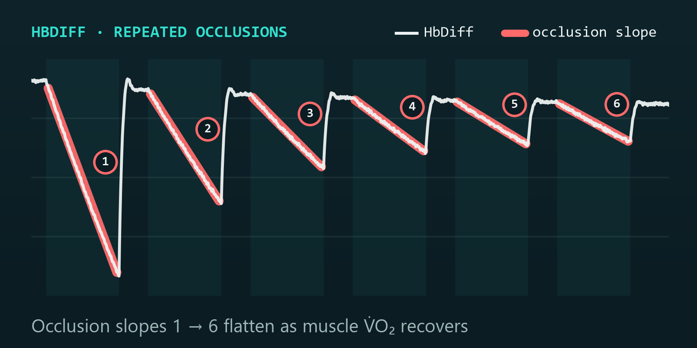
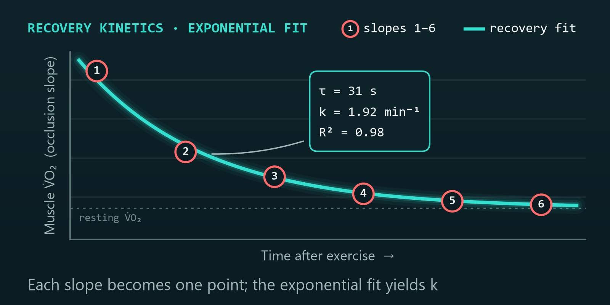
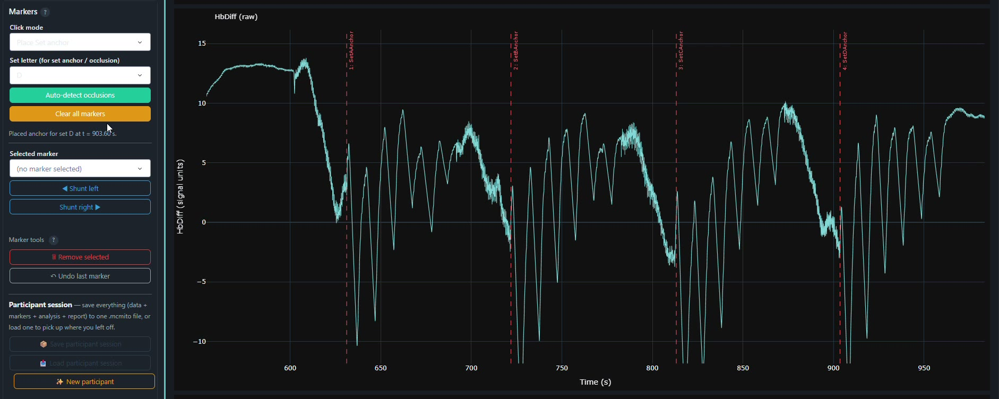
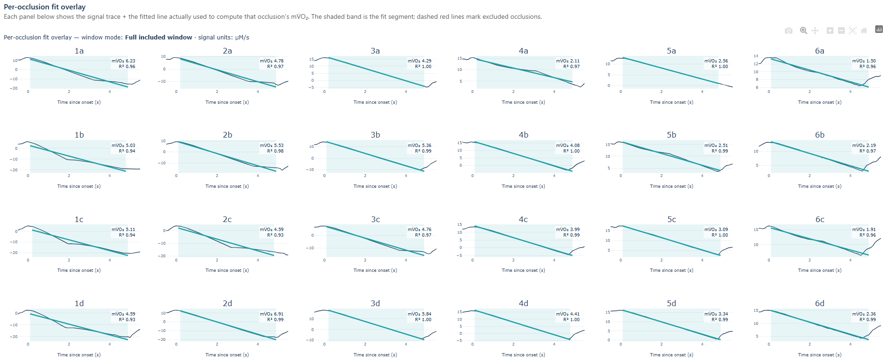
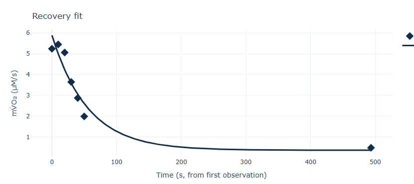
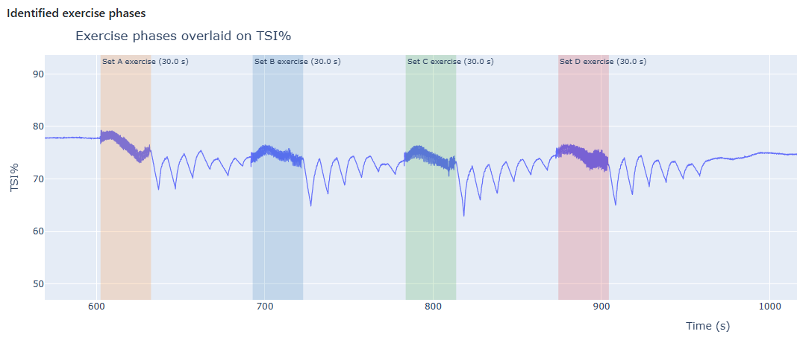

  <picture>
    <source media="(prefers-color-scheme: dark)" srcset="img/mcmito-logo-dark.png">
    
  </picture>

<h3 align="center">Near-infrared spectroscopy analysis of skeletal-muscle mitochondrial oxidative capacity</h3>

  
  
  
  

---

## Latest release

| | |
|---|---|
| **Version** | **1.4.3** (28 October 2026) |
| **Download** | [MCMITO_Setup_1.4.3.exe](https://github.com/McManus-C/McMito-releases/releases/latest), from the *Assets* list on the release page |
| **DOI** | [10.5281/zenodo.22647702](https://doi.org/10.5281/zenodo.22647702) |
| **Website** | [www.mcmito.com](https://www.mcmito.com) |
| **Contact / licence keys** | cmcman@essex.ac.uk |

**What's new in 1.4.3**

- **Analysis settings no longer revert after Compute slopes.** A display element that failed to draw could make the page undo your most recent setting changes and re-run *Compute* with the defaults. MCMITO now blocks that roll-back and logs the failing element to `%USERPROFILE%\.mcmito\frontend_errors.log`.
- Algorithm version 2 (unchanged). Results are identical to 1.4.2.

**What's new in 1.4.2**

- **McMito Live session files open.** 1.4.1 could not open `.mcmito` files saved by McMito Live (*'utf-8' codec can't decode byte 0x80*); the missing reader is now included.
- **Sensor dropouts load as blanks, not zeros,** for McMito Live recordings, and downsampling keeps a gap a gap.
- **The Protocol boxes now drive the analysis.** Edits to sets, occlusions per set, cycle period and occlusion duration after loading now update auto-detect, the slope and Method 1 windows, the fit overlay and the Excel metadata.
- **Cuff markers from a McMito Live session** for an imported raw device file, so auto-detect is not needed.
- **Per-occlusion fit figure** keeps its panel size for long protocols (for example 2 × 17), each set on a new row.
- **Data Cleaning:** the controls scroll on their own, and a fixed readout in each plot's title strip replaces the floating hover box.
- Algorithm version 2 (unchanged).

**What's new in 1.4.1**

- **Exercise periods and force dose.** Exercise periods are now markers you can place and correct, taken from your markers, a McMito Live protocol record, the 1.3.0 look-back or signal variance. Each period gets NIRS response metrics, and recordings with a force gauge get time under load, impulse, % MVC, repetitions and an exploratory dose–response fit. New Excel sheets and an optional PDF section.
- **McMito Live recordings.** Opens sessions recorded by [McMito Live](https://github.com/McManus-C/McMito-Live-releases), the companion acquisition and cuff-control app, and imports its raw device files on the session clock. Because Live records O2Hb and HHb as levels that include the sensor's starting offset, rather than as changes from zero, its data open with blood flow correction Method 4 (Beever, 2020); the Ryan methods remain available with a caution.
- **Resting occlusion optional.** Slopes, the recovery fit and the Excel export run without Rest markers; fit methods that need the resting value are disabled with an explanation.
- **Crop and Downsample on saved sessions**, keeping the markers.
- **Much faster plots.** A full Data Cleaning render on a 34-occlusion recording fell from about 12 s to 0.36 s; plots no longer go blank after repeated re-renders; linked zoom works across all five plots again.
- **Fixes and changes.** *Check for updates* says when nothing has been published; a session opened at launch keeps its saved correction method; licence keys are issued per product (existing keys remain valid). Algorithm version 2 (unchanged): the 10-participant validation cohort gives numeric outputs identical to 1.3.0.

Full history: [CHANGELOG](#changelog) below.

> Already running **1.1.0**, **1.2.0** or **1.3.0**? Use *Settings → About → Check for updates* and the app will install 1.4.3 for you. Running **1.0.0a1**? That version predates the updater, so download and run the 1.4.3 installer once; it installs over the top and keeps your licence.

---

## What MCMITO does

MCMITO is a desktop application that turns repeated-cuff NIRS recordings into reproducible measures of skeletal-muscle mitochondrial oxidative capacity. It implements the repeated arterial-occlusion method of Ryan et al. (2012): a series of brief cuff occlusions after a short exercise stimulus, the muscle oxygen consumption (mV̇O₂) measured from the haemoglobin slope during each occlusion, and the recovery of mV̇O₂ over time fitted with a mono-exponential curve to yield a rate constant (*k*) and time constant (*τ*).

  
  

The whole pipeline runs locally on your machine. Your data never leave it.

### Capabilities

| | |
|---|---|
| **Automated occlusion detection** | Consensus detection finds every cuff occlusion in each set and places the markers for you, each with a confidence score you can accept, shunt or remove. |
| **Manual marking** | Place, move and remove set anchors and occlusion markers by hand on full-resolution traces, with instant feedback. |
| **Correction and calibration** | Blood flow correction by Ryan et al. (2012) Methods 1–3 or Beever et al. (2020), and physiological 0–100 % calibration, are built in. |
| **Per-occlusion slopes** | mV̇O₂ extracted from each occlusion, with a choice of slope window (full included window, steepest sub-window or best-fit sub-window), and automatic exclusion of low-R² and negative-slope occlusions. |
| **Recovery-curve fitting** | Mono-exponential fit of mV̇O₂ against time to *k* and *τ*, with standard errors and R² quality tiers, per set and combined. |
| **Exercise and force analysis** | Exercise periods as markers (from your markers, a McMito Live protocol record, a fixed look-back or signal variance), NIRS response metrics per period, and force dose (time under load, impulse, % MVC, repetitions) with an exploratory dose–response fit for recordings with a force gauge. |
| **Three data sources** | Artinis OxySoft exports (PortaMon, PortaLite, OxyMon), Train.Red FYER session exports, and recordings from [McMito Live](https://github.com/McManus-C/McMito-Live-releases), with automatic format detection and a common channel-mapping dialog. |
| **Transparent and reproducible** | Every per-occlusion slope, exclusion and fit is visible and exportable. Each export records the software and algorithm version. |
| **Publication-ready exports** | One click to a full Excel workbook and a formatted PDF report. Save and reload a complete participant session (`.mcmito`) to pick up where you left off. |

---

## How it works

**1. Import.** Drag in your NIRS recording: an Artinis OxySoft export, a Train.Red FYER session export or a McMito Live raw device file (McMito Live sessions open directly with *Load participant session*). Map channels once; MCMITO remembers the layout. For Train.Red files the sample rate is inferred from the timestamps and the recording is regularised onto a uniform time grid.

**2. Detect and mark.** Auto-detect occlusions per set, or place and refine markers by hand.

  

**3. Correct and calibrate.** Apply blood-volume correction and physiological calibration to the signal.

**4. Fit.** Extract per-occlusion slopes and fit the recovery curve to *k* and *τ*. Every fitted line is shown alongside its mV̇O₂ and R², and exclusions are visible rather than hidden.

  

  

**5. Export.** Save the Excel workbook and PDF report, and archive the full session.

  

---

## Download and install

1. Open the [latest release](https://github.com/McManus-C/McMito-releases/releases/latest) and download **`MCMITO_Setup_<version>.exe`** from the *Assets* list. (The `manifest.txt` file alongside it is used by the app's own update check; you do not need it.)
2. Run the installer, accept the licence agreement when prompted and follow the steps. MCMITO installs per user, so no administrator rights are needed, and appears in the Start menu.
3. On first launch, choose where MCMITO should save your files (default `Documents\MCMITO`).

### Activating your licence

MCMITO requires a licence key, which is currently provided **free of charge** for research and educational use.

1. On first launch you will see an **activation screen** showing your **Machine ID**.
2. Copy the Machine ID and email it to **cmcman@essex.ac.uk**.
3. You will receive a **licence key** in return. Paste it into the activation screen and click **Activate**.

Each licence is tied to one computer and runs for a fixed period; the app warns you before it expires, and renewal is simply a new key for the same Machine ID. If you change computers, request a new key with your new Machine ID.

### System requirements

- Windows 10 or 11 (64-bit).
- No Python or other dependencies; everything is bundled.
- The app opens in its own window using Windows WebView2 (built into Windows 11 and most updated Windows 10). If WebView2 is unavailable it falls back to your default web browser.

### Updating

From version 1.1.0, use *Settings → About → Check for updates*. The app only installs releases published here that carry a valid signature and matching checksum. Your licence key and preferences are preserved.

---

## Built on the method

MCMITO implements the established repeated-cuff NIRS method for muscle mitochondrial capacity:

> Ryan TE, Erickson ML, Brizendine JT, Young HJ, McCully KK. Noninvasive evaluation of skeletal muscle mitochondrial capacity with near-infrared spectroscopy: correcting for blood volume changes. *Journal of Applied Physiology*. 2012;113(2):175–183. https://doi.org/10.1152/japplphysiol.00319.2012

Blood flow correction Method 4 and the best-fit slope window follow:

> Beever AT, Tripp TR, Zhang J, MacInnis MJ. NIRS-derived skeletal muscle oxidative capacity is correlated with aerobic fitness and independent of sex. *Journal of Applied Physiology*. 2020;129(3):558–568. https://doi.org/10.1152/japplphysiol.00017.2020

The analysis pipeline has been validated against synthetic NIRS recordings with known recovery kinetics, so the pipeline is shown to recover the truth before it sees your data.

## How to cite

If you use MCMITO in your research, please cite the software together with the underlying method (and Beever et al., 2020, if you use Method 4 or the best-fit window):

> McManus, C. (2026). *MCMITO: Near-infrared spectroscopy analysis of skeletal-muscle mitochondrial oxidative capacity* (Version 1.4.3) [Computer software]. Zenodo. https://doi.org/10.5281/zenodo.22647702

---

## Licence and intended use

MCMITO is **proprietary, licensed software** provided under an End-User Licence Agreement shown during installation. This repository holds installers and update manifests only; it does not contain source code.

MCMITO is intended for **research and educational use only and is not a medical device**. It is not for the diagnosis, prevention, monitoring, prediction, prognosis, treatment or alleviation of disease, and it has not been assessed by the MHRA or any other regulatory authority. You are responsible for independently validating any results you rely on.

## Changelog

### 1.4.3 — 28 October 2026

- Fixed: analysis settings (signal, min samples per slope and others) could revert to their defaults a few seconds after *Compute slopes*, and *Compute* then re-ran with the defaults. The page framework undid recent input changes whenever a display element failed to draw; that roll-back is now blocked.
- New: a display element that fails to draw shows a notice and is logged to `%USERPROFILE%\.mcmito\frontend_errors.log`.
- Unchanged: algorithm version 2. Results are identical to 1.4.2.

### 1.4.2 — 19 October 2026

- Fixed: `.mcmito` files saved by McMito Live open (1.4.1 was built without the parquet reader they need). A build without it now says so plainly.
- Fixed: for McMito Live recordings, an SmO2, O2Hb or HHb of exactly 0 (the sensor's "no reading") loads as a blank, with tHb blank wherever O2Hb or HHb is. OxySoft and Train.Red app files are unchanged.
- Fixed: Downsample keeps a blank sample local instead of blanking the filter length around it; data without blanks downsample exactly as before.
- Fixed: the Protocol boxes (sets, occlusions per set, cycle period, occlusion duration) now apply to auto-detect, the slope window, the Method 1 windows, the fit overlay and the Excel metadata when edited after loading. Markers are kept; slopes and fits from the previous protocol are cleared, with a message.
- Fixed: the per-occlusion fit figure keeps the 4 × 6 panel size for any number of occlusions, and each set starts on a new row.
- New: *Load cuff markers from .mcmito* after importing a McMito Live raw device file.
- Interface: Data Cleaning controls scroll independently of the plots; a fixed hover readout per plot replaces the floating hover box.
- Unchanged: algorithm version 2. Results change only for a McMito Live recording with a sensor dropout inside an analysis window.

### 1.4.1 — 12 October 2026

- New: exercise periods as markers (*Add Manually → Exercise periods*); the Exercise Stimulus tab takes periods from the markers, a McMito Live protocol record, the 1.3.0 fixed look-back or signal variance, writes estimated periods as markers, and adds change from start to end, change from the resting baseline, desaturation slope, time to minimum, mean of the last 2 s and the post-exercise nadir.
- New: force dose for McMito Live recordings with a Tindeq Progressor (time under load, impulse, mean and peak force, % MVC, repetitions, duty cycle, CV, fatigue index, MVC table, force trace figure) and an exploratory dose–response fit.
- New: Excel sheets `ExercisePeriods`, `ExerciseMetrics`, `ForcePeriods`, `ForceReps`, `MVC`, `DoseResponse`, `ExerciseSummary` and optional `ForceTrace` (`ExercisePhases` kept for this release); optional *Exercise and force* section in the PDF report.
- New: McMito Live sessions and raw device files (`*.trainred.raw.csv`, session clock kept, tHb derived, off-skin packets skipped); McMito Live data open with blood flow correction Method 4 (Beever, 2020); Ryan Methods 1–3 on McMito Live's offset-including O2Hb / HHb show a caution recorded as `BFWarning` in the Excel metadata.
- New: `MCMITO.exe --open <file.mcmito>` opens a saved session at launch.
- Changed: the resting occlusion is optional for slopes, the recovery fit and the Excel export (`RestingMeasure: none`); fit methods that need the resting value are disabled without it.
- Changed: Crop and Downsample work on saved sessions and keep the markers; Downsample keeps the record's time origin.
- Changed: much faster marker overlays (34-occlusion recording: full render about 12 s → 0.36 s, marker move about 2.4 s → 0.03 s); no WebGL, so plots no longer go blank after repeated re-renders; linked x-axes restored.
- Changed: licence keys are issued per product (MCMITO or McMito Live); existing MCMITO keys remain valid. The packaged self-test checks every module and writes `%USERPROFILE%\.mcmito\selftest.txt`.
- Fixed: *Check for updates* distinguishes "nothing published" and server errors from no network; a session opened at launch keeps its saved correction method.
- Unchanged: algorithm version 2 (10-participant validation cohort identical to 1.3.0); sessions and preferences from 1.3.0 open as before. 1.4.0 was an internal build and was not released.

### 1.3.0 — 30 September 2026

- New: blood flow correction Method 4 (Beever et al., 2020, incremental), alongside Ryan et al. (2012) Methods 1–3; the Data Cleaning label reads "Blood Flow Correction Method" with the source of each method.
- New: best-fit sub-window slope mode (highest R², as used by Beever et al., 2020, or lowest RMSE; physiological-direction windows only); tooltips for all slope window modes.
- New: default trims by window mode (full window 0.5/0.5 s; steepest and best-fit 0.0/0.0 s).
- New: PDF methods section with references; slope settings saved in `.mcmito` session files and recorded in the Excel metadata.
- New: in-app licence renewal (*Settings → Licence*).
- New: redesigned marker panel (*Auto Detect* / *Add Manually*, guided click placement with ticks, anchors matching the set count, detected occlusions listed per set, untick to re-place, Edit panel with nudge, arrow keys, snap and drag, *Apply* check for manual marking, help icons).
- New: blood flow correction and calibration shown as steps 1 and 2 with progress and confirmation; *Undo calibration*; loading a new recording resets the analysis and report fields.
- Changed: the default correction method in *Settings → Defaults* is now applied; Robust (Huber) slope fitting removed; *About & Cite* shows the software citation and DOI, with licence wording that refers to the EULA. Algorithm version 2.
- New: re-applying blood flow correction or calibration clears slopes and fits computed on the signals it changes; tooltip on *Export results to Excel* explaining that the export re-runs the analysis with the current settings.
- Fixed: *Compute slopes* and *Fit recovery curve* could fail silently (results appeared stuck) after entering values such as 0.75 s or R² 0.82, and sub-window lengths such as 2 or 5 s reverted to 3 s; number boxes now accept any decimal in range (arrow steps of 0.1 for trims, R² thresholds and window length), invalid boxes are named, unexpected errors raise a notice, and recomputing slopes clears the old recovery fit.
- Unchanged: sessions and preferences from 1.2.0 open as before.

### 1.2.0 — 7 September 2026

- New: Train.Red FYER `.csv` session import with automatic format detection; default mapping uses the `unfiltered` channels and `Lap/Event`.
- New: sample rate inferred from the timestamp column for seconds-based files (gap-robust estimate, snapped to the nominal device rate); native timing statistics shown in the mapping dialog.
- New: regularisation of irregular timestamps onto a uniform grid by linear interpolation (default on; switchable).
- New: import provenance (`Source.Import.*`) in the Excel Metadata sheet, a source line in the PDF footer, and the import mapping stored in `.mcmito` session files.
- Changed: unrecognised-file message lists supported formats; Time-column rate detection uses the gap-robust estimator.
- Unchanged: OxySoft import, analysis outputs, session-file schema (algorithm version 1).

### 1.1.0 — 28 August 2026

- New: in-app software updates (*Settings → About → Check for updates*).
- New: "as-displayed" results sheets in the Excel export (`SlopeResults_Displayed`, `OcclusionSummary_Displayed`, `FitSummary_Displayed`); the Metadata sheet records user-excluded occlusions.
- New: first-run save-location prompt (default `Documents\MCMITO`).
- Fixed: saves no longer overwrite earlier files of the same name.
- Fixed: PDF report staleness guard when exclusions change after fitting.
- Fixed: *Settings → Export preferences* now saves correctly in the installed desktop app.

### 1.0.0a1 — 25 June 2026

- First packaged release: standalone Windows application with native window, machine-bound time-limited licence activation, protected analysis core, installer and configurable output folder.
- Analysis platform: import and channel mapping, marker placement and auto-detection, blood-volume correction, physiological calibration, per-occlusion slope extraction with automatic low-R² and negative-mV̇O₂ exclusion, recovery-curve fitting (*k*, *τ*, SE, R²), exercise-stimulus metrics, Excel and PDF exports, and participant-session save/load.

---

## Contact

Chris McManus — University of Essex — cmcman@essex.ac.uk — [www.mcmito.com](https://www.mcmito.com)

© 2026 Chris McManus. All rights reserved.
